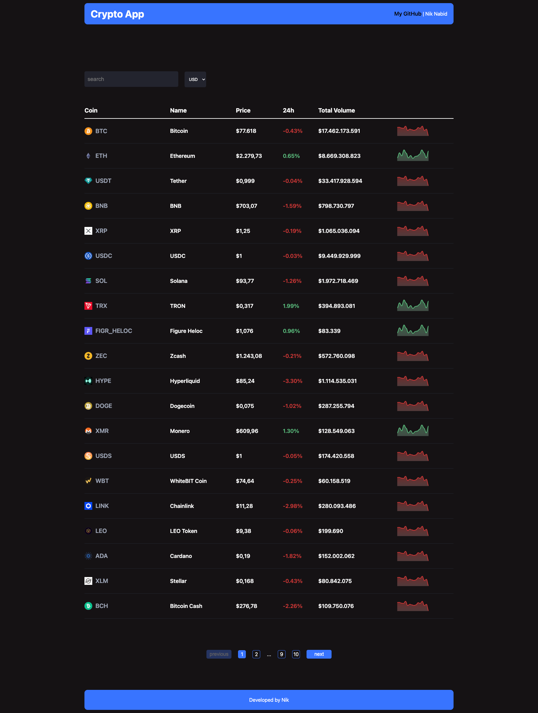

# Crypto App 📈

A cryptocurrency dashboard built with **React** and **Vite**. This project explores API-driven interfaces, reusable React components, and data visualization for cryptocurrency information.

## ✨ Features

- **Cryptocurrency browsing** — explore cryptocurrency information in a clean interface.
- **Coin search** — look up cryptocurrencies by name or symbol.
- **Data visualization** — display cryptocurrency data using Recharts.
- **Loading feedback** — provide visual loading states while requests are in progress.
- **Component-based architecture** — organize the UI with reusable React components.

> **Project status:** Actively developed. Features and UI may change as the project evolves.

## 🛠️ Tech Stack

| Technology | Purpose |
| --- | --- |
| React 19 | User interface and component state |
| Vite | Development server and production builds |
| JavaScript | Application logic |
| Recharts | Data visualization |
| React Loader Spinner | Loading indicators |
| ESLint | Code quality and linting |

## 🚀 Getting Started

### Prerequisites

- Node.js and npm installed on your machine

### Installation

1. Clone the repository:

   ```bash
   git clone https://github.com/MojtabaNabid/crypto-app.git
   ```

2. Navigate to the project directory:

   ```bash
   cd crypto-app
   ```

3. Install dependencies:

   ```bash
   npm install
   ```

4. Start the development server:

   ```bash
   npm run dev
   ```

5. Open the local URL shown in your terminal (typically `http://localhost:5173`).

## 📜 Available Scripts

| Command | Description |
| --- | --- |
| `npm run dev` | Start the Vite development server |
| `npm run build` | Create a production build |
| `npm run preview` | Preview the production build locally |
| `npm run lint` | Run ESLint checks |

## 📸 Screenshots




## 🎯 Learning Goals

This project is an opportunity to practice:

- Building reusable React components
- Managing component state and side effects with React Hooks
- Fetching and displaying data from APIs
- Handling asynchronous requests and loading states
- Visualizing data in interactive charts
- Structuring and maintaining a modern frontend project

## 🔮 Possible Future Improvements

- Favorites or watchlist functionality
- Additional chart time ranges
- Improved filtering and sorting
- More detailed cryptocurrency pages
- Accessibility and responsive UI refinements

## 👨‍💻 Author

**Mojtaba Nabid**  
GitHub: [@MojtabaNabid](https://github.com/MojtabaNabid)

---

If you find this project useful, feel free to give it a ⭐!
